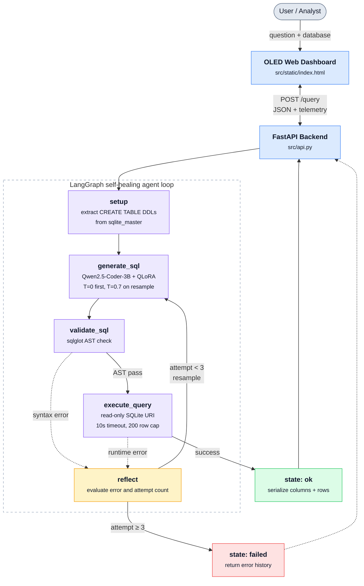

# Text-to-SQL Analyst Agent

[](https://pytorch.org/)
[](https://developer.nvidia.com/cuda-zone)
[](https://github.com/artidoro/qlora)
[](https://github.com/langchain-ai/langgraph)
[](https://fastapi.tiangolo.com/)
[](https://www.docker.com/)
[](https://yale-lily.github.io/spider)
[](LICENSE)
[](https://colab.research.google.com/github/Dhruvish-28/Analyst-Agent/blob/main/notebooks/analyst_agent_colab.ipynb)

> **Autonomous, privacy-preserving Text-to-SQL analyst agent powered by a fine-tuned local language model (`Qwen2.5-Coder-3B-Instruct`), AST validation guards, and a self-healing LangGraph reflection loop running on consumer GPU hardware.**

---

## Try It in 5 Minutes (No Install)

1. Click the **Open in Colab** badge above.
2. Choose **Runtime → Change runtime type → T4 GPU**, then **Runtime → Run all**.
3. When the last cell finishes, ask questions in plain English. Pick one of the sample Spider databases, or upload your own `.sqlite`, `.db`, `.csv`, `.tsv` or `.xlsx` file (50 MB max).

The first run takes about 5 minutes, mostly downloading the ~6 GB base model. Uploaded files stay inside your Colab session and are opened read-only.

## Overview

Enterprise data analytics often faces a dilemma: sending proprietary database schemas and analytical questions to hosted commercial LLMs risks data leakage and incurs ongoing API token costs. Running large models locally demands costly datacenter-grade accelerators.

This project demonstrates a production-grade, privacy-first alternative:

1. **Local Parameter-Efficient Fine-Tuning (PEFT)**: Fine-tuned `Qwen/Qwen2.5-Coder-3B-Instruct` with 4-bit QLoRA on a single **NVIDIA GeForce RTX 3060 12GB** under a tight **4.00 GB peak VRAM ceiling**, completing 1 epoch across 5,000 verified SQL pairs in **~30 minutes**.
2. **Empirical Benchmarking**: Measured performance before and after fine-tuning against **100 fixed, unseen Spider dev benchmark questions** across 18 distinct SQLite databases. Fine-tuning boosted the **Valid-SQL rate from 86.0% to 95.0%** (a **64% reduction in syntax/schema errors**).
3. **LangGraph Self-Healing Agent**: Built a cyclic state machine agent wrapping the model with `sqlglot` AST validation and read-only SQLite execution. Using stochastic resampling, the agent autonomously self-heals runtime execution errors, elevating the final **Valid-SQL rate to 97.0%** (+11.0% over the un-tuned base model).
4. **Full-Stack Delivery**: Packaged with a typed **FastAPI REST API**, an **OLED dark-mode Web Dashboard**, a **GPU-accelerated Docker container**, and a **one-click Google Colab notebook** that works with sample or user-uploaded data.
---

## System Architecture



### Safety & Guardrails

- **Read-Only SQLite URI**: Databases are mounted with `file:{path}?mode=ro`, guaranteeing that disk mutations (`INSERT`, `UPDATE`, `DROP`, `ALTER`) are rejected at the SQLite engine level.
- **AST Parsing (`sqlglot`)**: Enforces single-statement `SELECT` queries (allowing `WITH` CTEs and `UNION` sets). Rejects multi-statement or non-SELECT operations before execution.
- **Progress Handler Timeout**: SQLite progress handler halts queries that exceed 10 seconds, preventing runaway joins or infinite loops.
- **Result Row Capping**: Memory exhaustion is prevented by truncating output sets at 200 rows.

---

## Empirical Benchmark & Evaluation Results

All configurations were evaluated on the **exact same 100 fixed Spider dev benchmark questions** across 18 SQLite databases (`data/processed/eval_questions.json`, seed `42`). Benchmarks were executed on an NVIDIA GeForce RTX 3060 12GB (Windows 11 Native, PyTorch 2.6.0+cu124).

### Benchmark Comparison Table

| Model / Configuration                    |     Retry Strategy     | Execution Accuracy (EX) |   Valid-SQL Rate   | Avg Latency | Avg Attempts / Query | Artifact File                                       |
| :--------------------------------------- | :--------------------: | :---------------------: | :----------------: | :---------: | :------------------: | :-------------------------------------------------- |
| **Base Qwen2.5-Coder-3B** (Untuned)      |   None (Greedy, T=0)   |   **61.0%** (61/100)    | **86.0%** (86/100) | **1.911 s** |         1.00         | `results/baseline_20261111_204423.json`             |
| **Fine-Tuned 3B** (1-Epoch QLoRA)        |   None (Greedy, T=0)   |   **59.0%** (59/100)    | **95.0%** (95/100) | **5.510 s** |         1.00         | `results/finetuned_3b_20261111_213542.json`         |
| **Merged Standalone 3B** (Fused Weights) |   None (Greedy, T=0)   |   **63.0%** (63/100)    | **93.0%** (93/100) | **1.566 s** |         1.00         | `results/merged_3b_20261113_153431.json`            |
| **LangGraph Agent** (Fine-Tuned)         | `error_feedback` (T=0) |   **57.0%** (57/100)    | **95.0%** (95/100) | **3.540 s** |         1.12         | `results/agent_error_feedback_20261112_214029.json` |
| **LangGraph Agent** (Fine-Tuned)         | **`resample`** (T=0.7) |   **58.0%** (58/100)    | **97.0%** (97/100) | **3.626 s** |       **1.11**       | `results/agent_resample_20261112_213417.json`       |

> [!NOTE]
> **Understanding the Numbers & Statistical Context**:
>
> - **Sample Size**: On a fixed 100-question benchmark, a ±2% to ±3% difference in Execution Accuracy falls within the standard binomial sampling margin of error (±4.8% for N=100). The base model and fine-tuned model are statistically tied on semantic correctness.
> - **Valid-SQL Mastery**: Fine-tuning produced an unambiguous **+9.0% absolute increase in Valid-SQL rate** (86.0% → 95.0%), eliminating **64% of syntax and schema invalidity errors**.
> - **The Self-Healing Loop**: The LangGraph agent using stochastic resampling further elevated Valid-SQL to **97.0%** (+11.0% over baseline), with an average of 1.11 attempts per query.
> - **Latency & Token Horizons**: Baseline (1.911 s) and fine-tuned QLoRA adapter (5.510 s) were evaluated with `max_new_tokens=256` (the 5.510 s latency reflects dynamic PEFT forward-pass overhead on top of 4-bit quantized base weights). Standalone merged weights (1.566 s) and LangGraph agent runs (3.540 s / 3.626 s across up to 3 retry steps) used `max_new_tokens=128`, where weight fusion eliminates adapter overhead entirely.

---

## Why Resample Beats Error Feedback

The LangGraph agent was tested with two distinct self-healing retry strategies:

1. **`resample`**: On a syntax or runtime error, attempts 2 and 3 resample the model with temperature T=0.7 and top-p=0.9 without modifying the prompt context.
2. **`error_feedback`**: On error, attempts 2 and 3 append the error message into the prompt (_"That query failed with: {error}. Return a corrected query."_).

```
Evaluation Metric           Resample (T=0.7)        Error Feedback (Multi-Turn)
--------------------------------------------------------------------------------
Valid-SQL Rate              97.0% (+11.0% vs Base)  95.0%
Execution Accuracy (EX)     58.0%                   57.0%
Self-Healed Queries         1 (tvshow eval #97)     0
Avg Attempts / Query        1.11                    1.12
```

### Empirical Insight

- **Distribution Mismatch**: The model was fine-tuned exclusively on **single-turn ChatML prompt-completion pairs** (`system` + `user` schema & question → `assistant` SQL). Multi-turn error injection introduces an **out-of-distribution (OOD)** conversational pattern that the 3B parameter model was never trained to handle, often causing it to hallucinate or repeat the same schema mistake.
- **Stochastic Exploration**: In contrast, stochastic resampling (T=0.7) breaks deterministic greedy failure loops while staying strictly within the model's learned single-turn distribution. This allowed the model to discover valid alternative table aliases and join paths without prompt corruption.

---

## Failure Mode & Error Analysis

A qualitative audit of 15 incorrect queries on the unseen Spider dev benchmark (`results/failure_analysis.json`) revealed four primary failure categories:

| Error Category                       |      Share (Count)      | Description & Example Root Cause                                                                                                                                             |
| :----------------------------------- | :---------------------: | :--------------------------------------------------------------------------------------------------------------------------------------------------------------------------- |
| **Schema Linkage & Multi-Hop Joins** | **40.0%** (6/15)        | Referencing columns from related tables without performing the requisite `JOIN`, or selecting child tables due to aggregation keywords.                                      |
| **Complex Set & Aggregation Logic**  | **33.3%** (5/15)        | Substituting `OR` or `IN` subqueries where relational set intersection (`INTERSECT`) was required for multi-row entity constraints, or replacing `COUNT(*)` with `SUM`.     |
| **Column Projection Order**          | **13.3%** (2/15)        | Generating the correct data columns but in inverted positional order (e.g., `SELECT Population, Name` vs gold `SELECT Name, Population`), causing positional tuple mismatch. |
| **Condition Literal Mismatches**     | **13.3%** (2/15)        | Formatting discrepancies in string literals (e.g., filtering `WHERE Citizenship != 'French'` vs gold `WHERE Citizenship != 'France'`).                                       |

### Example of failure on a complex query

On database `car_1`, the question _"Which company's car model has the highest horsepower?"_ requires traversing four distinct relational tables connected by foreign keys:

```
car_makers (Id, Maker)
   └── model_list (ModelId, Maker)
         └── car_names (MakeId, Model)
               └── cars_data (Id, Horsepower)
```

A 3B model fine-tuned on 1 epoch of synthetic data struggles with relational pathfinding across 3 intermediate junction tables, frequently attempting to join `car_makers` directly to `cars_data`. This highlights a natural capability ceiling for compact 3B models: while 1-hop and 2-hop joins are mastered, multi-hop junction pathfinding requires either explicit schema graph pruning, foreign-key graph prompting, or scaling to larger model sizes (e.g., 7B–14B).

---

## Hardware & Training Specifications

Fine-tuning was conducted natively on consumer desktop hardware:

| Parameter               | Specification                                                                                                                                                                   |
| :---------------------- | :------------------------------------------------------------------------------------------------------------------------------------------------------------------------------ |
| **Base Model**          | `Qwen/Qwen2.5-Coder-3B-Instruct`                                                                                                                                                |
| **Host Hardware**       | NVIDIA GeForce RTX 3060 (12.00 GB VRAM)                                                                                                                                         |
| **Operating System**    | Native Windows 11 (Python 3.11, CUDA 12.4, PyTorch 2.6.0+cu124)                                                                                                                 |
| **Quantization**        | 4-bit NormalFloat (NF4), Double Quantization, `bfloat16` compute dtype                                                                                                          |
| **LoRA Parameters**     | Rank r=16, Alpha α=32, Dropout 0.05 targeting all 7 linear projections (`q, k, v, o, gate, up, down`)                                                                           |
| **Adapter Size**        | **59.9 MB** (`output/final_adapter/`)                                                                                                                                           |
| **Peak VRAM**           | **4.00 GB** (under 35% of the 12GB hardware limit)                                                                                                                              |
| **Training Duration**   | **~30 minutes** (312 optimizer steps, 1 epoch across 5,000 samples)                                                                                                             |
| **Final Training Loss** | **0.5100** (starting from 2.908 in smoke test)                                                                                                                                  |
| **Data Cleaning**       | 5,000 synthetic pairs filtered via `sqlglot` AST parsing and verified via in-memory SQLite execution; sample `INSERT` statements stripped to prevent schema distribution shift. |
| **Leakage Audit**       | Verified 0 question overlap against Spider dev evaluation benchmark (`results/leakage_check.txt`).                                                                              |

---

## Project Structure

```text
text-to-sql-analyst-agent/
├── README.md                           # Master project documentation & portfolio presentation
├── LICENSE                             # MIT Open Source License
├── ENGINEERING_LOG.md                  # Comprehensive decision log (19 decisions, 6 incidents)
├── pyproject.toml                      # Project metadata, pinned dependencies, tool configs
├── docker-compose.yml                  # Single-command GPU container configuration
│
├── docker/
│   └── Dockerfile                      # GPU runtime container (Ubuntu 22.04 + CUDA 12.4 + PyTorch)
│
├── configs/
│   └── qlora_qwen3b.yaml               # QLoRA hyperparameters, LoRA target modules, training args
│
├── src/
│   ├── sql_tools.py                    # Schema extraction, read-only URI, AST safety, row comparison
│   ├── agent.py                        # LangGraph cyclic StateGraph with dual retry strategies
│   ├── api.py                          # Production FastAPI REST backend with Pydantic schemas
│   ├── evaluate.py                     # Standalone evaluation harness on 100 Spider dev questions
│   ├── evaluate_agent.py               # Evaluation harness for LangGraph self-healing agent loop
│   ├── merge_adapter.py                # Merges LoRA adapter into 16-bit standalone weights
│   ├── train.py                        # QLoRA fine-tuning script via TRL SFTTrainer
│   ├── prepare_data.py                 # Gretel cleaning pipeline, AST validation, leakage checks
│   ├── setup_eval_data.py              # Automated download of 18 Spider SQLite databases & dev split
│   ├── test_gpu.py                     # GPU & bitsandbytes 4-bit NF4 sanity test harness
│   ├── analyze_failures.py             # Categorizes failed benchmark predictions into error taxonomy
│   └── static/
│       └── index.html                  # Dark-mode analyst UI (Tailwind CSS, Prism.js, telemetry)
├── notebooks/
│   └── analyst_agent_colab.ipynb       # Run-all Colab demo: sample databases + file upload, Gradio UI
├── tests/
│   ├── test_sql_tools.py               # Unit tests for read-only URI, timeouts, and AST guards
│   └── test_api.py                     # Integration tests for FastAPI endpoints & agent execution
│
├── data/
│   ├── processed/
│   │   ├── eval_questions.json         # 100 fixed Spider dev benchmark questions (seed 42)
│   │   └── train.jsonl                 # 5,000 sanitized ChatML training examples
│   └── spider_db/                      # 18 downloaded SQLite benchmark databases
│
├── output/
│   ├── final_adapter/                  # Trained LoRA adapter weights (59.9 MB)
│   └── merged_model/                   # Optional standalone fused weights (via merge_adapter.py)
│
└── results/                            # Persistent evaluation JSON and CSV logs
    ├── baseline_20261111_204423.json   # Base model scores: 61.0% EX, 86.0% Valid-SQL
    ├── finetuned_3b_20261111_213542.json # Fine-tuned scores: 59.0% EX, 95.0% Valid-SQL
    ├── merged_3b_20261113_153431.json  # Merged model scores: 63.0% EX, 93.0% Valid-SQL
    ├── agent_resample_20261112_213417.json # Resample agent: 58.0% EX, 97.0% Valid-SQL
    ├── agent_error_feedback_20261112_214029.json # Feedback agent: 57.0% EX, 95.0% Valid-SQL
    ├── failure_analysis.json           # Categorized 15 failure samples
    └── leakage_check.txt               # Verified 0 training/eval overlap
```

---

## Quickstart & Installation

### Option 1: Google Colab (Easiest, Free GPU)

Open [`notebooks/analyst_agent_colab.ipynb`](notebooks/analyst_agent_colab.ipynb) in Colab with a T4 GPU runtime and run all cells. No local setup, GPU or Docker needed.

### Option 2: Native Local Setup (Recommended for Windows / Linux)

#### 1. Clone & Setup Virtual Environment

```bash
git clone https://github.com/Dhruvish-28/Analyst-Agent.git
cd Analyst-Agent

# Create virtual environment with Python 3.11
python -m venv .venv

# Activate virtual environment

# On Windows:
.venv\Scripts\activate
# On Linux/macOS:
source .venv/bin/activate

# Install dependencies with PyTorch CUDA 12.4
pip install --upgrade pip
pip install torch torchvision torchaudio --index-url https://download.pytorch.org/whl/cu124
pip install -e .
```

#### 2. Download Benchmark Databases

The 18 Spider benchmark SQLite databases (~100 MB) are downloaded on demand:

```bash
python src/setup_eval_data.py
```

> _This populates `data/spider_db/` with all 18 SQLite databases and verifies `data/processed/eval_questions.json`._

#### 3. Run Hardware & Safety Tests

```bash
# Verify GPU detection & 4-bit quantization
python src/test_gpu.py

# Run unit and integration test suite
python -m pytest tests
```

#### 4. (Optional) Fuse Weights for Maximum Inference Speed

By default, the repository runs with the base model and lightweight 59.9 MB LoRA adapter (`output/final_adapter/`). To eliminate adapter computation and achieve the fastest query latency (~1.56s):

```bash
python src/merge_adapter.py
```

> _Note: The Agent and FastAPI backend automatically detect and switch to `output/merged_model/` once created, with zero extra configuration._

#### 5. Launch the Analyst Web Dashboard & API

```bash
python -m uvicorn src.api:app --host 127.0.0.1 --port 8000
```

Open your browser to: **`http://localhost:8000`**

---

### Option 3: Docker Deployment (GPU-Accelerated)

Prerequisites:
1. Docker Desktop with WSL2 backend (Windows) or NVIDIA Container Toolkit (Linux).
2. Download Spider evaluation databases before building:
   ```bash
   python src/setup_eval_data.py
   ```

```bash
# Build and run container with GPU pass-through
docker compose up --build
```

Access the dashboard at `http://localhost:8000`.

---

## Reproducing the Benchmark Results

To re-run the evaluations across the fixed 100 Spider dev questions:

```bash
# 1. Evaluate un-tuned base model
python src/evaluate.py --model-name Qwen/Qwen2.5-Coder-3B-Instruct

# 2. Evaluate fine-tuned QLoRA adapter
python src/evaluate.py --model-name Qwen/Qwen2.5-Coder-3B-Instruct --adapter-path output/final_adapter

# 3. Evaluate merged standalone model (if merged locally)
python src/evaluate.py --model-name output/merged_model --config-name merged_3b

# 4. Evaluate LangGraph self-healing agent (Resample strategy)
python src/evaluate_agent.py --strategy resample --max-retries 3

# 5. Evaluate LangGraph self-healing agent (Error feedback strategy)
python src/evaluate_agent.py --strategy error_feedback --max-retries 3
```

Results are saved automatically to `results/` in both JSON and CSV formats.

---
## Using Your Own Data

The Colab notebook accepts:

| Input | How it is handled |
| :--- | :--- |
| `.sqlite` / `.db` | Used directly (read-only) |
| `.csv` / `.tsv` | Converted to a single SQLite table |
| `.xlsx` | Each sheet becomes a table |

Column names are cleaned to `snake_case`, and files are capped at 50 MB. The model was trained on prompts of at most 1,024 tokens, so for databases with many tables only the tables matching your question (plus tables they reference through foreign keys) are sent to the model.

**Limitations:**
- **SQLite only.** Connecting to Postgres or MySQL is not supported yet.
- **Expect lower accuracy than on Spider.** Real-world schemas are messier, and a 3B model struggles most with multi-table joins and ambiguous column names (see the failure analysis above). Always read the generated SQL before trusting a result.

## Future Roadmap

1. **GGUF Quantization & Local Serving**: Export the merged standalone model to GGUF format (Q4_K_M) for high-throughput, low-latency execution via Ollama and llama.cpp.
2. **7B Model Scaling**: Benchmark `Qwen2.5-Coder-7B-Instruct` with QLoRA to evaluate whether 7B parameters natively resolves the 4-table join barrier.
3. **Schema Graph Pruning**: Implement networkx-based foreign key pathfinding to inject minimal relevant table subgraphs rather than complete database DDLs.
4. **Multi-Turn Training**: Fine-tune on synthetic (Error, Corrected SQL) tuples to align the model specifically for conversational error feedback.
5. **Natural Language Result Summarization**: Integrate a lightweight secondary local LLM call to synthesize table outputs into business insights.
6. **Postgres / MySQL Support**: Connect to live databases, using `sqlglot` to transpile the model's SQLite output and `information_schema` for schema extraction.
7. **Publish to Hugging Face Hub**: Host the adapter and merged weights so users can skip the merge step.

---

## License

This project is licensed under the MIT License. See [LICENSE](LICENSE) for details.
